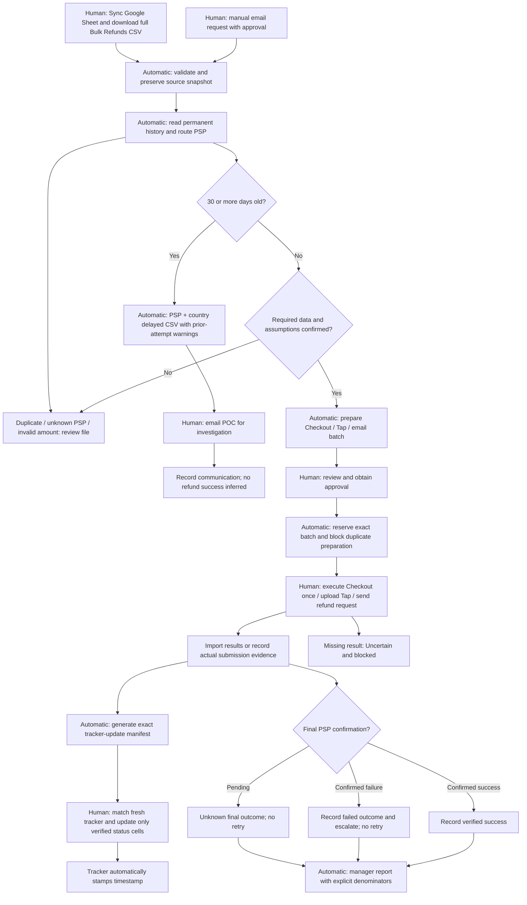

# Phase 1 workflow

Prepared, Reserved, Submitted, RequestFailed and Uncertain are submission states. Final status is separately Unknown, ConfirmedSuccessful, ConfirmedFailed or Voided. A prepared file, a reservation and an investigation email never enter the tracker-update manifest.
